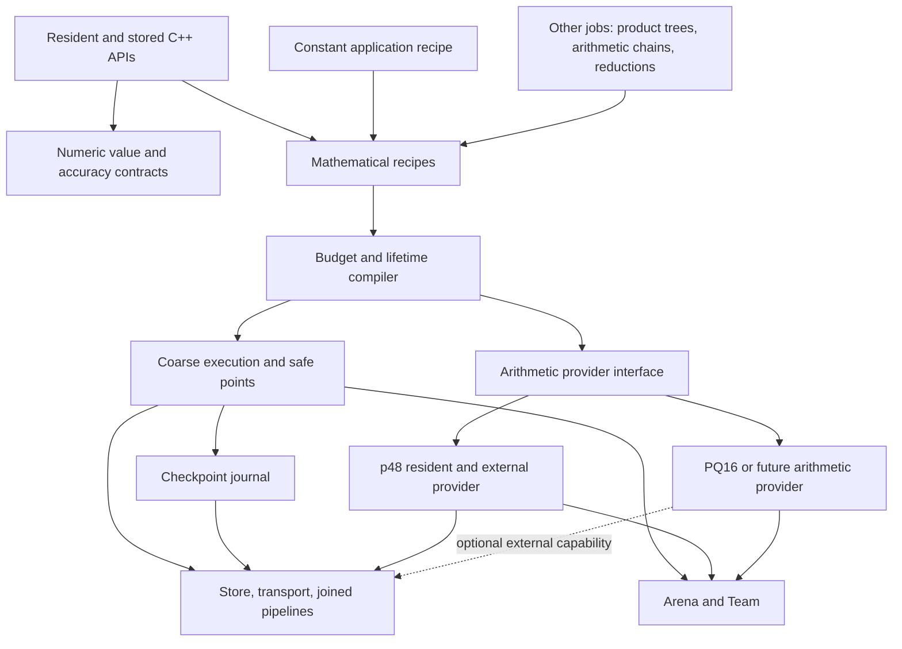

# OOC architecture cleanup and extension boundaries

Design proposal, 2026-10-05. OOC performance development is paused at the user's
request. This document proposes a refactoring order; it does not declare new
APIs implemented or change current arithmetic, storage or recovery contracts.
The companion [bigfloat roadmap](bigfloat-roadmap-2026-10-05.md) builds on these
boundaries. No compilation, benchmark or SSD experiment accompanies this review.

The main recommendation is to **retain the current execution engine and expose
its real boundaries**. A generic storage layer, an arithmetic-provider layer
and a job-independent recovery layer are useful. A universal FFT-pass interface,
a new general-purpose DAG runtime and transparent disk-backed limb pointers are
not prerequisites.

## 1. What the code actually separates today

| Existing asset / location | Keep | Coupling to remove |
|---|---|---|
| `external/io`, `file_store`, `values`, most of `store` | Joined IO, immutable values, explicit reservations, quotas and deferred retirement | Keep numeric summaries outside the byte-store contract; separate observers from the transport |
| `external/scratch_plane`, `chunk_writer`, `two_slot` | Exclusive mutable scratch, epoch checks, retained prefixes, bounded overlapping stages | Name the byte/range primitive independently of modular planes; extract the join/slot mechanics, not the arithmetic loops |
| `planning/resources.hpp` | Checked layout and lifetime admission | Its six roles include exactly three result slots; make the underlying layout consume bounded slot descriptions, retaining the three-output series adapter |
| `planning/product.hpp/.cpp`, `external/spilled_product.hpp` | Successful p48 selection, retention, streaming and traffic calculations | The allegedly generic request/plan exposes NP, T, outer/inner cells, CRT, ten scales and a concrete p48 plan |
| `external/shared.hpp` | Shared-table accounting once per context | It explicitly adds p48 and PQ16 banks; replace that arithmetic assumption with a prepared-resource set |
| `external/newton.hpp`, `format.hpp`, `series_merge.hpp` | Numerical recurrences, rounding barriers, input windows and complete-episode admission | They embed `SpilledProductPlan` and `RowCachePlan`; clients should retain opaque arithmetic programs and certified reuse handles |
| `external/job.hpp` | Correct phase ownership and replacement semantics | This is a **constant-job** plan: series -> quotient -> root -> fixed -> radix, not a general job representation |
| `external/checkpoint.hpp/.cpp` | Publication protocol, UNKNOWN handling, write reservations, restore/GC | It includes `job.hpp`, switches on `JobPhase`, and has five hard-coded value records/pins |
| `external/integer.hpp` | Immutable magnitude views, virtual scaling and resource ownership | `StoredInteger` and `ResidentInteger` already mean signed dyadics `M*2^e`; their names conceal the foundation needed by floats |
| Public C++ `context`, `execution`, `integer_view` | Explicit resources, eager convenience, allocation-free `_into`, real resident spans | These are resident APIs. An mmap allocator must not silently turn them into OOC APIs |

These are dependency issues, not evidence that the numerical algorithms need a
rewrite. For example, the series implementation already serves custom formula
families; it is the surrounding *constant finishing state machine* that is too
specific to serve arbitrary jobs.

## 2. Desired dependency graph

Arrows below mean "uses". Individual backend templates stay inside their ISA
islands; a dispatch at program preparation or a coarse stage is sufficient.



Storage knows byte extents and integrity, not primes or constants. Recipes know
operations, accuracy and lifetimes, not packed48 layouts. Backends know how to
execute within a grant, not which formula converges or when an application
wants a checkpoint. Recovery knows a root schema and value versions, not a pi
terminal or a Newton rung's private fields.

## 3. Six contracts to extract

### A. Numeric metadata and access rights

Introduce a shared internal dyadic description: sign, magnitude support,
binary exponent and exact known facts. Keep mathematical accuracy separately:
an exact stored dyadic may be only an approximation to an intended real value.
Public floating precision is also separate from physical limb capacity.

Split `SourceWindow` into pure virtual-word mapping metadata and resident/store
reader adapters. Keep its checked shifts, zero extension and physical checksum
domain. Select an adapter once per stage; do not dispatch through a virtual
reader for every limb. A whole-word view or exponent adjustment must not create
a normalization file.

| Ownership | Permission |
|---|---|
| Resident borrow | Read a real span for its admitted lifetime; preserve caller values |
| Sealed stored value | Immutable data/version; consuming the handle may retire it after its last read, not overwrite it |
| Private mutable artifact | Exclusive, epoch-checked update; previous readers and IO must join before reuse |
| Building output | Discardable on failure; expose only after its integrity and numerical contract are established |
| Checkpoint root | Retain old and candidate roots through uncertain publication; ordinary uniqueness is not overwrite authority |

Rename the internal scaled wrappers to `StoredDyadic` / `ResidentDyadic` during
migration, with temporary aliases. Keep integer APIs restricted to integer
semantics and add float-specific precision/classification above the same
magnitude machinery. Do not rename the approximate quotient into an exact
integer division.

### B. Backend-neutral arithmetic programs

The shared request should contain operation, operand descriptors, requested
output/window, accuracy and ownership. Backend selection constraints may be
supplied separately. NP/T/WD, CRT scales, packed48 and row geometry belong to
the selected p48 implementation.

Minimal private provider surface:

| Entry | Contract |
|---|---|
| `capabilities(request)` | Resident/external support; exact or bounded-error result; legal reuse and fusion; explicit unsupported |
| `metadata_bound(request)` | Caller-provided plan-storage requirement |
| `compile(request, grant, prepared_set, plan_storage)` | One selected opaque program, full resource/traffic receipt, semantic output contract |
| `prepare(program, bindings)` | Explicit fallible resource boundary where necessary; no hidden hot allocation |
| `execute_resident` / `execute_external` | Preserve existing void/fatal resident arithmetic and fallible IO contracts respectively |
| `can_reuse(artifact, request)` | Identity/state/scale/support/ownership checks, not just equal transform length |

The provider owns its internal pass recipe. A double-FMA FFT is not required
to manufacture prime planes or a CRT pass. The p48 provider wraps the existing
forward/middle/final pipeline intact, including its in-place scratch updates,
raw retention, tile fusion and alternate witnesses.

Keep the existing resident `Backend` registry as the starting point; add an
optional external-program adapter, rather than a competing algorithm registry.
Provider capabilities can be incomplete. Adding a resident backend must not
oblige the author to implement OOC immediately, and a pinned unsupported
external request must fail at query time rather than silently change semantics.

Small resident requests retain direct thresholds and leaf calls. They do not
enter this compiler, acquire Store handles or build a stage graph.

### C. Resource receipts and retained state

Use one shared `Budget` / `ResourceReceipt` vocabulary for RAM, live backing,
normal reads/writes, worst-case witness writes, workers, IO queues, metadata,
outputs and cleanup/commit overhead. `normal` and `worst` traffic are different
fields. Memory admission uses exact checked bounds; timing estimates never
make an unsafe plan admissible.

A `PreparedSet` names tables/resources by backend, representation/version and
machine key and charges their union once. The context owns/pins these resources;
build them at explicit preparation points and reuse them afterward. This
replaces unconditional p48/PQ16 charging in `external/shared.hpp` without
introducing an unaccounted process cache.

Initially keep one controlling top-level operation per context. Concurrent jobs
would need disjoint budget leases and a shared-resource/write-budget authority;
they must not each spend the same nominal RAM or write allowance. This is an
extension boundary, not another scheduler to implement during cleanup.

The global compiler keeps the existing three decisions:

1. Subtree/precision/required outputs and child order.
2. Legal fusion, last reads, reusable artifacts and materializations.
3. Arithmetic lowering and backend-private placement inside the grant.

Keep structured sequence/fork/loop recipes and summary recurrences. Generalize
fixed slot-role arrays only into bounded caller-owned descriptions, not an
unbounded graph or a heap node per digit/tile. Existing constant-size array
adapters remain useful for hot recipes. The p48 prefix fitter and cache/stripe
formulas move behind its adapter; they are not general rules for every backend.

### D. A reusable execution shell

Share reservation, joined slot ownership, ledger accounting, failure draining,
safe-point cancellation and output publication. Keep compute callbacks and
their scratch layouts specialized. Reuse the existing two/three-slot protocol
without requiring a new scheduler or flattening a recursive arithmetic job
into millions of generic tasks.

Cancellation and resource growth occur at declared boundaries. Resident kernels
remain allocation-free/non-failable after admission. IO failure stops new
dependent work, drains the existing workers/requests, discards unpublished
outputs and preserves the prior state. Destructors must not perform disk IO.
Numerical flags of a future float API are not transport errors or invariant
failures.

The output adapter receives finalized chunks and typed numerical observations.
The byte Store retains XXH3-64 integrity. Integer m61 checks, normalization,
carry, float rounding and error certificates are numerical responsibilities.
Their implementation may remain fused into the same physical loop; separation
of ownership does not require another pass or a per-limb callback.

### E. Job-independent checkpoint roots

Split the current class into a transaction journal and a constant-state adapter.
The adapter supplies a versioned state schema, its live value records and the
next stable step. The journal owns sync/rename/directory-sync, pins, UNKNOWN,
write-intent reservations, verification/import and GC.

Replace the fixed five-record assumption with a bounded root capacity quoted
before execution. Use an explicitly versioned bounded manifest; a larger root
may need immutable manifest pages referenced by the atomic head. No raw C++
objects, callback addresses or backend-plan bytes are serialized. Preserve the
old decoder/protocol until an explicit format migration is implemented.

Separate mathematical step identity from physical execution identity:

- Step identity: job/formula schema, input value versions, requested semantics,
  precision, rounding/error contract and algorithmic position.
- Execution identity: backend/basis, layout, retention, worker/IO policy and
  machine profile.

This makes future replanning from canonical values possible. It does **not**
turn today's strict same-build recovery into a cross-version or cross-backend
promise. Persistent spectrum artifacts remain backend-specific and optional;
incompatible artifacts can only be rebuilt from still-available canonical
inputs under a new admitted plan.

### F. One mathematical programming model, explicit storage behavior

Retain `integer_view` and future `float_view` as actual resident spans. Provide
separate immutable stored owners/views. Neither a stored object nor an operator
overload should fault arbitrary numeric pages from disk or pretend to provide
`data()`.

Resident and external frontends can lower the same typed mathematical request.
Explicit external preparation supplies placement, write/backing budgets,
cancellation and a checkpoint policy; running it returns an IO outcome.
Materializing a stored result is an explicit operation with its own bound.
The existing eager C++ convenience path remains useful and fast.

Do not automatically reassociate floating expressions. `a*b+c` and an explicit
FMA have different rounding contracts. The shared request must retain rounding
barriers and source accuracy; fusion is legal only when it preserves the
requested semantics or selects a separately specified approximate recipe.

## 4. Suggested source ownership after extraction

Names are proposals, not an instruction to move all files immediately.

```text
src/storage/                  io, regions, immutable values, files, checksums
src/execution/                resource receipts, slots, joined pipelines, journal
src/numeric/                  dyadic descriptors, word views, summaries, accuracy
src/product/                  arithmetic requests, registry, opaque program/reuse interface
src/backend/ntt_p48/external/  present p48 geometry, planes, CRT, retention and pass runners
src/algorithms/...            shared Newton / numerical recipes and resident lowering
src/series/...                formula facts, subtree and precision recipes
src/radix/...                 conversion recipes, resident and external lowering
src/jobs/constants/           present JobSpec/JobPlan/JobState and checkpoint adapter
```

Move definitions after consumers have switched interfaces. Private typed p48
plans stay typed and inlineable inside their backend. Do not replace them with
a universal vector class or move intrinsics into public headers.

## 5. Refactoring sequence and exit gates

| Work package | Change | Required evidence |
|---|---|---|
| C0: freeze contracts | Document value rights, result/error semantics, resource receipts and checkpoint schema; distinguish implemented facilities from historical plans | Current source/binary identities and existing receipts retained; no numerical-policy change |
| C1: numeric/storage split | Pure word views and dyadic metadata; typed summary adapters; storage no longer depends on jobs/backends | Existing Store/IO/shifted-window/linear gates, same bytes and ownership |
| C2: arithmetic adapter | Wrap current p48 external implementation; replace embedded concrete plans in Newton, radix and series with opaque program/reuse references | Same selected arithmetic, numeric output, actual IO, live-data bounds and streaming paths |
| C3: recovery adapter | Extract journal, bounded root records and application state codec; keep constant runner as first adapter | Existing crash/UNKNOWN/write-reservation gates plus a non-constant two-step product job and a root with more than five values |
| C4: extension proof | Existing native PQ16 as resident-only provider plus a small test-only external arithmetic provider with no primes/CRT | Generic planner/job/storage build without p48 includes; unsupported capabilities reject early; test provider produces exact small results |
| C5: API consolidation | Expose explicit resident/stored preparation around shared requests; reconcile stale documentation | Usage examples demonstrate caller-owned values, retained programs, explicit materialization and failure handling |

This is a sequence of small vertical changes, not a rewrite. C1 and bigfloat's
value/rounding foundation can proceed together. Bigfloat development should
not wait for every file move or a new production OOC backend.

Contract freezing in C0 means stabilizing semantics and ownership for the
refactor. It does not freeze the proposed private structs or a speculative new
public ABI. Existing public C interfaces stay compatible.

Refactoring acceptance preserves the current kernel schedule, old/new root
safety, virtual-zero views, in-place disposable B planes, read-only caches,
integer carry checks and output certificates. Compare semantic plans, not raw
opaque padding. No extra full-value/plane pass is acceptable as abstraction
overhead. Use the existing exact/failure tests first; run the established fresh
non-power-of-two checks after a coherent refactor, not after every rename.
No SSD test is needed for source movement or unchanged transfer schedules.

## 6. Stop line for this round

Do not add a second optimized OOC transform backend, a universal task scheduler,
arbitrary pass-level restart, transparent paging, multidevice tuning, or new
constant algorithms as part of cleanup. Existing specialized emitters stay
specialized. Public OOC availability remains an operation capability, not a
promise that every integer/float/math function can spill.

Some existing OOC documents still end with pre-qualification statements and
old resource examples. Reconcile those status paragraphs as their owning
modules are extracted; preserve historical experimental receipts. The current
implementation/performance record remains in the private research checkout,
not in a release-facing claim that the proposed interfaces already exist.
