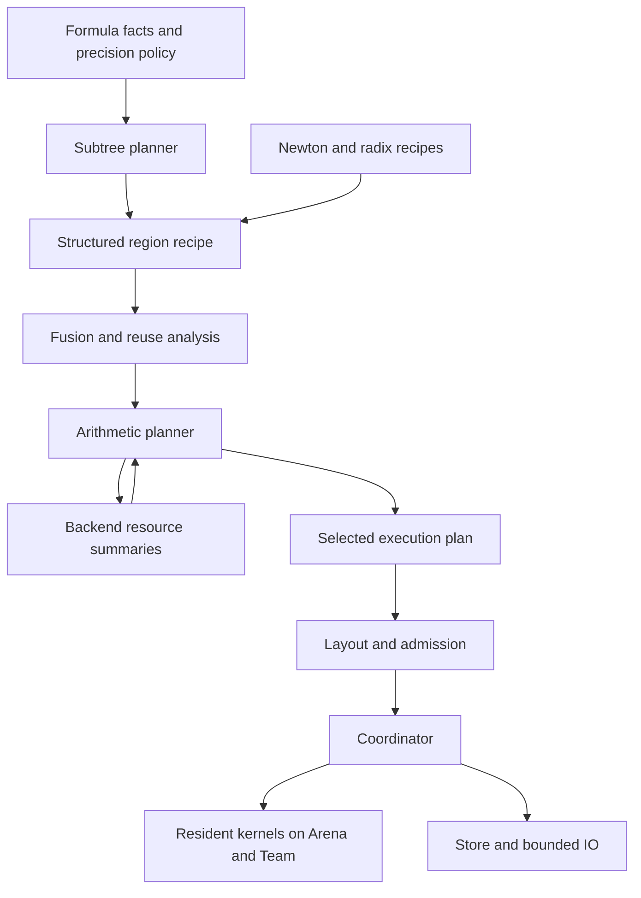

# Out-of-core planner design

Design decision, 2026-10-02. This specifies the implementation to build; it does
not announce an implemented OOC API. Existing resident services and their ABI
remain unchanged. The planner is a **recursive budget compiler**: establish the
mathematical recipe, combine its lifetimes, select a bounded execution policy,
then assign concrete storage. No exhaustive schedule or cache-subset search is
part of production planning.

The first hardware acceptance remains 5B decimal digits of pi, on the current
Zen5 machine, one device, with total resident RAM at least 4 GiB. The same
interfaces serve custom Hyperdescent, CommonP2B3 and BinaryBBP formulas, Newton
finishing and radix conversion. The 2B / 4,6,8,12 GiB YC matrix is a behavioral
reference, not a native libsbn performance qualification.

## 1. Components and direction of dependency



|Owner|Decides|Must not decide|
|---|---|---|
|Subtree planner|Ranges, required precision, demanded T/D/U outputs, resident frontier, child order and worker grants|Prime set, codec or individual transform tiles|
|Fusion/reuse analysis|Legal streamed expressions, last reads, output materializations, compatible reuse epochs|Different rounding semantics or arbitrary algebraic reassociation|
|Arithmetic planner|Whole-episode resident promotion, product grouping, workspace and retained-data grants|Formula convergence or a new precision schedule|
|Backend|Arithmetic basis, root legality, kernel geometry, execution regimes, storage/traffic formulas|Budget outside its grant or lifetime of unrelated values|
|Layout/coordinator|Named-slot bindings, original IO/task joins, ready kernel dispatch|New algorithms, unquoted spills or implicit allocation during arithmetic|

Division, rsqrt and SRT export recipes over products; they do not implement
their own disk allocators. Small resident calls continue through their existing
thresholds and direct storage queries. Nothing here is inserted into their hot
wrappers. A new multiplication backend implements the resource/program adapter;
it does not require rewriting the series planner.

## 2. Minimum descriptions

These are private design types, not public C structs. All arrays below are
bounded spans in explicit planning storage; an `Id` is a stable logical index,
never a process pointer or hash alone used as a safety proof.

|Description|Required fields|
|---|---|
|`PlanRequest`|Operation/formula identity and parameters; demanded result; precision/error policy; input views/versions and ownership; output placement/durability; repeat intent|
|`FormulaFacts`|Conservative value and serial-depth bounds; exact-span bound; contraction/tail facts; growth/work estimates; legal split callback; semantic/policy version|
|`Budget`|Total resident cap; owned disk cap; remaining submitted-write cap; workers; prepared shared-state set; device and cost-profile identity; optional checkpoint policy|
|`ValueDesc`|Kind/sign; logical support and capacity bound; exponent; accuracy/rounding contract; semantic producer/version; known zeros|
|`ValueUse`|Value/view and logical range; read/consume rights; required completion/scale/support; last-read event; conditional witness reads|
|`RegionRecipe`|Sequence/fork/repetition structure; node/rung parameters; value uses/definitions; precision barriers; output contract; symbolic counts|
|`ReuseEpoch`|Immutable operand view; ordered compatible uses; required representation; build and last-use events; source availability if rebuilding|
|`SlotEnvelope`|Role-indexed capacities/alignment; return slots; per-phase simultaneous sets; consume/overlap permissions; shared preparation set|
|`KernelSummary`|Opaque selected recipe token; `SlotEnvelope`; grouped retention capabilities; common/worst traffic; peak backing; work/span estimate and its provenance|
|`ExecutionPlan`|Recipe generator; selected tokens; grants and layout templates; transfer/worker limits; arithmetic/execution identities; resource receipt|
|`RunBindings`|Actual Arena ranges, Team scopes, Store versions, prepared tables, IO slots, cancellation and operation state|

The four earlier layers remain distinct: mathematical `ProductSpec`, backend
`ArithmeticPlan`, physical `ExecutionPlan`, and actual `RunBindings`. An IO
layout change need not change arithmetic identity. A change of precision cuts,
rounding barriers, codec/basis or numerical recipe does.

Spectrum compatibility includes basis, index order, completion state, scale and
support. Backend compatibility checks may accept a view or a specified
conversion; equal transform size is insufficient. Stored representations also
name their wire format and backend version. Canonical values remain independent
of the backend. Plans carry no YC-specific constants or dependency on research
files.

## 3. Planning lifecycle and bounded work

The internal lifecycle is:

```text
metadata_bound(request) -> planning/storage upper bound
compile(request, budget, providers, prepared_metadata_span) -> plan + receipt
prepare(plan, context, Store) -> bindings or resource/IO error
run(plan, bindings) -> result or IO/cancellation status
```

The cheap metadata query does not compile the plan once and discard it.
Compilation stores selected decisions; preparation replays their layouts and
initializes tables without repeating policy selection. A convenience context
may acquire metadata at an explicit fallible preparation boundary. Planning
memory, including temporary candidates, belongs to the resident budget.

Execution contains a generator and a depth-bounded frontier, not a graph of all
terms, limbs or tiles. At a joined coarse boundary, actual scalar headers may
instantiate a previously admitted shape template. This can reclaim capacity;
it cannot weaken a bound, change precision, select an unadmitted family or
trigger a plan search inside a kernel. No inverse value is needed to determine
the later division product shapes.

Memoize summaries by numerical request/envelope, worker count, policy/profile,
shared-table state and relevant budget class. Store the chosen token for replay.
A bounded memo may evict entries; eviction changes planning time, not meaning.
Sizing a serial subtree uses its depth envelope rather than visiting every leaf.

Before distributing grants, collect a conservative shared-preparation bound for
the admitted provider families over the recipe's shape envelopes. Combine it
with already pinned context tables by identity. This is a cheap capability
query, not construction of every candidate's roots. Selected summaries name
their actual shared requirements, which must fit that bound; prepare only those
entries at a quiescent boundary. Any unused allowance remains slack until the
next coarse boundary. This prevents a circular policy in which a newly chosen
backend silently enlarges global tables after all RAM has been granted.

Each distinct arithmetic request/budget has at most **eight complete summary
quotes**, including resident, alternate reuse basis, correction and fallback.
This does not limit the number of distinct shapes in a job to eight. Geometry
recursion reduces the problem structurally; it is not a search over factorizations.
At most two workspace/retention estimate passes are allowed. Deduplicate tokens
before quoting. Only the chosen summary is lowered into a physical program.

Required instrumentation: bound/split evaluations, summary quotes, distinct
templates, replay misses, planning peak bytes, compile time and preparation
time. The provisional 5B planning-only target is 100 ms; it is not yet measured.
Fresh-call acceptance includes planning and all required preparation/cleanup.

## 4. Subtree planning

### Mathematical decisions precede placement

Use existing formula analysis to choose the stopping index and certify errors.
Let `a(x)` be the root-anchored attenuation bound in bits, and `p` the requested
root precision. The existing precision policy supplies a demand equivalent to
`max(p_floor, p - a(x) + guards)`, including amplitude and accumulated rounding
allowances. Differences of two root-anchored lower bounds are **not** generally
valid local attenuation bounds.

For precision blocks, solve the monotone estimate
`growth(begin,end) >= remaining_precision(end)` with the configured useful-work
floor. Use interpolation/Newton with bracketed bisection; require progress and
fall back to the item midpoint for unusable work estimates. No product-plan
trials enter this root finding. Precision and capacity still use their separate
conservative contracts.

Within a block, choose near-equal growth/work mass for the two ordered children.
Use the existing certified exact-suffix rule when every relevant intermediate
fits its required precision. Hyperdescent can therefore become one exact tree
without a separate family-selection heuristic. A smaller RAM grant causes more
external execution, not an unauthorized loss of precision or a division at each
block. Any new mathematical split policy is versioned in the numerical identity.

### Slot recurrence

For a fixed return contract, let `pL,pR` include each child's complete local peak
and `sL,sR` its retained return footprint. Shared outer state is excluded here
and charged once by the parent. Let `m` be the complete merge peak, including
both child returns, scratch and any genuinely distinct destination:

```text
serial_LR = max(pL, sL + pR, m)
serial_RL = max(pR, sR + pL, m)
parallel  = max(pL + pR, m)
```

For those fixed contracts, evaluating the child with larger `p-s` first minimizes
the serial RAM peak. Arithmetic operand order never changes. Disk envelopes use
the analogous retained-backing recurrence; if RAM/disk preferences disagree,
compare just the two child orders. Shared aliases are counted by storage owner,
not added once per view.

Templates use fixed roles and an explicit alias map. Sequential phases reuse
slots and take maxima; concurrent grants add. Alignment, padding and retained
return slots are included in those recurrences. This is an executable lane
layout, not an arbitrary interval-packing problem deferred until execution.
Packing/relocation, when necessary, has a separate byte/work charge.

### Resident suffix and execution decomposition

```text
E = empty named-slot envelope
for block in tail_to_head(precision_blocks):
    ordinary = summarize_resident(block, ordinary_decomposition)
    compact  = summarize_resident(block, one_extra_serial_level)
    proposal = smaller_layout(join_by_role(E, ordinary), join_by_role(E, compact))
    # Available candidates only; ties prefer ordinary. This choice is budget-independent.
    if proposal does not fit: stop
    E = proposal
    accept block

reserve E
for accepted block:
    if join_by_role(E, ordinary) fits the total budget:
        expand E and use ordinary
    otherwise keep the sizing choice
```

This is a capacity-first native baseline. It deliberately does not import YC's
observed 9/8 local-memory preference or its guard/task constants. Size first,
then realize ordinary decompositions using the final envelope and spare grant.
Do not choose ordinary prematurely merely because the current block fits.
The initial version of this design did so; implementation exposed a counterexample:
tail ordinary slots `(value=20, work=80)` versus compact `(40,20)`, followed by
another block requiring `(40,20)`. A 60-unit budget fits both with compact;
choosing ordinary immediately at 100 units would fit only the tail. The
budget-independent sizing sequence makes the resident frontier monotone for
fixed candidate summaries. Realization never removes accepted blocks. The
accepted suffix is still relative to this bounded policy, not a proof of the
globally best frontier.

Execute remaining prefix blocks tail-to-head, preserving each precision
barrier. Recursively split an external block until its subtrees fit their grants;
use depth summaries for the resident interiors. Do not impose the current
resident PSR controller's 128-block array as an external problem-size limit.

Arithmetic workers and simultaneous subtrees are separate. Initially allow one
external arithmetic episode at a time per device group. Fork resident siblings
only if both complete grants fit and the existing work/span estimate favors
the fork after dispatch cost. Split worker shares in proportion to work, rounded
to backend-supported useful widths; one ordinary allocation is sufficient.
Extra workers must not introduce unquoted spills. Team tasks receive disjoint
Frame slices, never competing bumps into a shared cursor.

## 5. Fusion and reuse are one local pass

Use fixed generic templates, with a bounded use-def/last-use pass over each
template. They contain product/window operations plus input/output adapters for
sign, shift, short scalar, add/subtract, crop, normalization and carry.

For CommonP2B3, the merge is

```text
D = DL * DR
U = UL * UR                         # only when demanded
T = TL * DR + UL * TR
```

Demand propagation removes unused outputs. `DR` and `UL` have explicit reuse
epochs. Hyperdescent replaces `UL` by one. BinaryBBP uses its sum merge and
absolute exponent views. These algebraic templates, not constant names, select
the consumers. A MAC or paired-product implementation is eligible only if its
coefficient/scale, signedness and output contracts cover this expression.
The current positive-product MAC API is not silently treated as signed MAC.

Fuse an adapter into a supported product ingress/egress when its value has no
other reader and its rounding/carry contract permits the move. Otherwise retain
one explicit streamed stage, priced as such. All-product results need not be
materialized just to feed an addition. Conversely a precision barrier or a
required witness cannot be erased because fusion looks faster.

A reuse epoch has two independent decisions:

1. **Representation:** build a spectrum once and preserve its mathematical state
   until the final compatible use, possibly across another product.
2. **Placement:** retain permitted ranges in RAM or leave their backing in Store.

After the last read, disposable source storage may become product/coefficient
storage. This requires both compute readers and original IO requests to join,
plus any conditional repair reader to finish. A cached immutable source cannot
be destroyed by the first consumer. Raw sources needed to rebuild a spectrum
remain live unless another admitted source exists.

## 6. One memory equation per complete arithmetic episode

For every resource phase `j`:

```text
fixed_shared + caller_pinned + control_IO_j + workspace_j
    + sum(live_retained_group_bytes_j) <= total_resident_budget
```

Include root tables, worker stacks, planning/control state, IO slots, checksum
pages, carry fringes, actual readable padding and outputs. Do not sum component
maxima whose lifetimes do not overlap; do not omit those that do. Already-backed
data may be logically live with no full RAM copy. Caller-pinned inputs cannot be
spilled behind the caller's back. An explicit transfer of ownership/placement is
needed before their bytes can be released.

`Budget` subtraction is owned by the parent and recorded once. The child gets
the remaining grant plus identities of shared objects it borrows; it does not
re-add the parent's retained state or assume it owns the whole job cap.

### Optional retention policy

The backend exports a few groups of aligned ranges, each with a lifetime,
permitted retained prefix/suffix/granularity, backing state, dependency and
benefit formula. Whole-spectrum logical reuse does not imply arbitrary per-tile
reuse is supported. Metadata and retained writer fragments are part of a group.

For an admitted workspace regime:

1. Reserve mandatory shared/pinned/control/working state across all phases.
2. Order optional groups by estimated saved time divided by
   `bytes * max(1, live_phase_count)`; break ties by nearer next use and stable ID.
3. Grant each the largest legal aligned amount fitting **every** phase of its
   lifetime. Update phase capacities directly, without per-page search.
4. Recompute actual traffic and preparation cost from those grants.

Savings are marginal: a backed range avoids reads; a dirty range avoids a write
only if it dies without a required backing publication. Reuse may save several
reads, but cannot repeatedly save the same write. Cache construction, source
spills/reloads, normalization and relocation are charged. Dependent benefit
groups are allocated together or re-evaluated after the prerequisite decision;
raw and spectral representations cannot both claim the same avoided work.

This greedy lifetime allocation is a heuristic. It is not an exact caching
solver. Its purpose is to prevent retaining whole values first and starving the
multiplier with the leftover space.

## 7. Multiplication selection from capacity laws

### Backend contract

The backend adapter provides these pure operations into prepared metadata:

```text
choose_basis(product_group, profile) -> ordinary arithmetic token
shared_bound(shape_envelopes, supported_regimes) -> preparation capacity bound
quote_resident(token, boundary_contract) -> complete episode summary
capacity_model(token, external_level) -> fixed + variable phase footprints
quote_external(token, execution_parameters, retention) -> complete summary
lower(selected_summary, actual_headers, grants) -> executable phase template
```

An existing compatible spectrum may nominate one alternative basis. Series and
division do not sweep NP/T or FFT factorizations themselves. `quote_envelope`
must cover every permitted shape/support in an envelope; querying only the
largest input is unsafe when backend switching makes storage non-monotone.
A backend may pin one bounded implementation and pad within it to discharge
this requirement. Lowering checks that actual dimensions/layout stay inside the
quote; this check is not a second policy search.

### Selection sequence

1. If the **complete resident episode**, including its boundary values, fits,
   use the existing resident policy. A resident product alone fitting is not
   sufficient to promote an entire division or SRT operation.
2. Otherwise obtain one canonical external geometry from the backend's root,
   cache-unit and transfer-alignment rules. The geometry chooses legal transform
   levels; it does not enlarge roots beyond their order. Add an external level
   only when the smallest legal working unit cannot fit.
3. From minimum legal row/transfer units, derive the maximum admitted prime
   batch. Propose bounded wave-count neighbors using the formula below, then
   derive balanced row chunks and retention for each proposal.
4. Recompute the displaced-retention estimate once. It may nominate one further
   legal batch; do not loop to convergence.
5. If limits reject the ordinary choices, quote one conservative supported
   low-spool/low-write fallback. Select among admitted summaries and lower once.

For prime batching, use phase bounds `H_j + g*V_j`, including indexes/fringes:

```text
g_max = min(NP, min_j floor((M-H_j)/V_j))
variable_cost(g) approximately A*NP/g + mu*V*g
g_est = clamp(sqrt(A*NP/(mu*V)), 1, g_max)
```

Zero-slope phases must fit separately. No legal batch when `g_max<1` triggers
the recursive/blocked provider, not rounding up to an illegal batch. `A` is the
cost of input/decode work actually repeated per wave; `mu` estimates the saved
time per RAM byte of the first displaced useful retention group; `V` is the
limiting footprint slope. If no useful retention is displaced, use the largest
useful batch. If no wave replay remains, use the smallest useful batch when
retention has positive value. Exact phase quotes, not this smooth cost proxy,
decide capacity and actual wave count.

Start with capacity-first retention under `g_max` to estimate `A,mu`. Around
`NP/g_est`, take the adjacent legal wave counts and derive their smallest batches
as `ceil(NP/waves)`. Add `g_max` and the smallest batch achieving its wave count.
Deduplicate: at most four first-pass batch proposals. The eight-quote ceiling
leaves room for resident, one reuse-basis proposal, one correction and fallback;
these are not crossed into a product grid. A reuse-basis proposal uses the same
capacity rule directly. Backends without prime batching supply their analogous
working-unit law, without exposing that distinction to consumers.

### Rows: capacity first, then balance

For fixed geometry and batch, if the per-row working footprint is `v`, fixed
state is `H` and there are `U` rows:

```text
r_max = floor((M-H)/v)               # minimum across all applicable phases
chunks = ceil(U/r_max)
rows_per_chunk = ceil(U/chunks)      # final chunk takes the remainder
```

First express rows in the backend's legal aligned unit. More general footprint
functions invert their conservative bound directly. Reject a unit that cannot
fit. After retention is assigned, verify the selected chunk footprint against
the remaining grant; retention must fit that footprint, not force an unplanned
new chunk size. The second estimate pass is the only opportunity to revise it.

Capacity-first chunking is the initial schedule, not an instruction to spend
all spare RAM on a bigger working batch. When useful retention is displaced,
the single correction proposal may also reduce rows per chunk. With fixed
batch, per-chunk setup cost `t` and displaced-retention value `mu`, use the proxy
`t*U/r + mu*v*r`, giving `r_est=sqrt(t*U/(mu*v))`. Clamp to the legal row range
and round the implied chunk count to its nearest legal integer; quote that one
complete corrected regime, rather than crossing row and prime grids. If `mu`
is zero, keep capacity-first rows. This explicitly allows an extra chunk to
save a much larger materialization; exact quoted traffic decides whether the
proposal wins. Both scalar proxies are heuristics, not optimality proofs.

Changing chunk count alone does not remove full-store reads/writes. For an
ordinary fully spilled three-pass product, with packed-plane size `P`, the
transformed payload is `3P` read and `3P` written; integer endpoints, padding,
indexes and boundary records are additional. Cached inputs, retention and fused
consumers change those actual passes. Count them from the selected program,
not from an empirical multiplier applied to operand length.

### Executable external-product policy (2026-10-02)

`planning/product` implements the first bounded provider policy for an operation
already lowered to external MUL/SQR. This is a subset of the eight-summary
whole-episode contract above, not a second policy in small resident kernels.

- One ordinary Bailey query supplies NP/T if they are not fixed by the request.
  Byte alignment and the exact external CRT capacity are checked afterwards.
- Let L be live cells, N their power-of-two envelope and W the worker count.
  The first inner length is `M0=max(1,N/8192,ceilpo2(min(N,4096W)))`.
  The second derives from balancing middle-row storage against inverse/carry
  storage: `M1=clamp(ceilpo2(cuberoot(4 L^2 64 NP Q / alpha^2)),M0,N)`.
  Here Q is the integrity quantum and alpha is 128 bytes/cell for MUL, 64 for
  SQR. These are proposal formulas, not substitutes for exact storage queries.
- Each geometry gets at most two stripe proposals. The first minimizes the
  smooth `A J+B/J` inverse/fringe bound, with prime batch one. The second uses
  the transfer target and complete-phase capacity bounds, then the bounded
  wave-batch estimate above. Duplicate proposals are skipped: at most four
  complete external summaries and one basis query, without a grid search.
- Each exact quote charges fixed/shared/private RAM and conservative owned
  backing. Spare RAM retains the largest allowed chunk-aligned B-family prefix.
  Each retained byte saves two reads and two writes before it is discarded.
  Retention is a placement adjustment to the quote, with no new arithmetic
  planning or operand traversal.
- Admitted candidates are priced for compute, decode replay, memory work,
  copying, transferred bytes and requests. The least-write candidate within
  the configured modeled slowdown allowance wins (default 5%). The current
  profile is an explicit analytic scenario, not a measured latency guarantee.

The budget includes caller-declared other live state and the shared p48 bank
once; it is not merely a private-scratch cap. Selection reports its quote count,
smallest quoted resident requirement and exact selected resources. Rejection
means this bounded policy found no admitted plan. It does not certify global
infeasibility. The current blocking coordinator executes the selected quote;
whole-job admission and resident promotion remain
integration work. Full backing is reserved even for retained payload, so the
disk-capacity estimate is conservative.

The stored-series compiler additionally composes one reusable common-row group
for its numerator/denominator products. It nominates a shared envelope from the
larger ordinary product, quotes it once and includes the cache's metadata, IO,
backing and complete lifetime. Cached applies preserve full carry/m61 checks.
The common raw source retires after build if no external pin needs it. Hard
episode caps are checked after this producer sharing, and the separate recipe
remains available. There is no cache-subset or geometry grid search. This first
group is transient outer Rows, not durable Columns or arbitrary spectral algebra.

## 8. Division, rsqrt and radix use the same compiler

|Consumer|Structured recipe|Reuse and return contract|
|---|---|---|
|Approximate division / inverse|Existing precision ladder, seed, cancellation/correction products and requested window|Group compatible inverse uses; consume residual/old approximation only after all reads; fuse final numerator product where supported|
|rsqrt / multiply-rsqrt|Existing seed/refinement ladder and terminal products|Same scale and precision barriers; no second full result merely to apply a final scalar/product|
|SRT formatting|Existing balanced or reusable power ladder; middle/wrap product; explicit low witness and digit seam|Power spectra have use epochs; right/left child fractions occupy disjoint grants; parent ranges retire after witness/last reads|
|Integer/fraction scaling|Existing exact/error-certified scale recipe around parsing/formatting|Compose scaling with the same tree grants, rather than reserve two complete service workspaces simultaneously|

SRT external traversal is depth-first with bounded sibling return state by
default. A child frontier becomes parallel only when the sum of complete grants
fits. Pending child data stays in disjoint parts of the admitted parent slab or
in explicitly backed slots. Do not allocate a fresh parent-sized slab at every
parallel depth; such a design reintroduces the `O(N log workers)` memory issue.
Seam/carry records, retained low witnesses and power preparation are included.
Resident subtree promotion keeps the existing tuned parallel implementation.

There is no OOC-specific numerical Newton/SRT rewrite. Extract their existing
shape generators from execution/binding and add resident/external adapters.
`WindowGroupChoice` and `ProductProgramPlan` remain product-owned tokens. A
service's current maximum precision/domain is a capability boundary until its
adapter is extended, not permission to silently truncate an external request.

## 9. Admission, disk traffic and execution

Resource receipts distinguish:

- Union of owned pinned backing versus newly required disk space.
- Peak live backing versus cumulative submitted bytes.
- Normal-path read/write totals versus worst admitted correction/retry paths.
- Numerical payload, padding, checksum indexes, manifests and checkpoints.
- Committed/locked/resident pages versus reserved virtual address space.

Use the existing XXH3-64 Store design (eight checksum bytes per integrity chunk,
default 16 KiB), without adding content-address hashing to arithmetic. Scratch
plane/index overwrites follow exclusive ownership; committed/checkpoint versions
remain immutable. Checkpoint pins are disk costs, not mandatory full RAM copies.
V1 multiplication is one recovery step: its private planes may be overwritten;
recover from committed values and recompute the step. Paid pass checkpoints are
a later policy with explicitly quoted retained generations.

Construct the default whole-job proposal, using template multiplicities and
conservative serial-depth bounds to accumulate disk/writes. A local replacement
must preserve its published return/ownership contract; otherwise it belongs in
the one separate fallback pass, not an unnoticed edit to its consumer's inputs.
Admit the complete job, including a conservative bound for the pending suffix,
before execution. Do not let locally legal operations each spend the entire
remaining write allowance. Worst-branch IO
includes the bounded retry policy; it is not a promise to survive arbitrary
repeated device failures within a finite cap.

If limits reject the throughput choices, make one supported conservative
fallback pass. Dropping a cache can increase recomputation and writes; re-quote
the result rather than assuming it saves both resources. Failure to admit that
policy reports **no plan found by this policy**, with limiting resource and
smallest quoted requirement. Only a proven mandatory bound permits a claim of
infeasibility. Missing provider support and metadata exhaustion are distinct.

The selected plan uses named slots with stable offsets within prepared Arena
ranges. Team kernels run only after their input IO/checksums complete. Slot
reuse waits for original IO completion and all compute/repair readers. Outputs
become externally visible only after carry/seam resolution, required checks and
the applicable Store publication protocol.

Resident arithmetic remains allocation-free and non-failable; broken bounds or
math invariants are fatal diagnostics. Metadata/page/file reservation and IO
are fallible outside that path. Cancellation stops admission of new IO/kernels,
drains current references and leaves committed roots intact; it does not inject
error returns into resident kernel callbacks. Unpublished partial results are
discardable. No runtime OOM fallback, surprise page growth or hidden spill is
permitted.

The controller's complete planning flow is therefore:

```text
facts   = analyze_request_and_existing_precision_policy(request)
recipe  = generate_coarse_recipe(facts)              # no per-term graph
recipe  = mark_barriers_and_fuse_local_templates(recipe)
shared  = bound_shared_requirements(recipe, providers)
grants  = compose_subtree_slots_and_resident_frontier(recipe, budget, shared)
normal  = select_bounded_arithmetic_summaries(recipe, grants)
receipt = accumulate_whole_job(normal)               # peaks, sums, branches
if receipt violates hard limits:
    normal = conservative_policy_pass(recipe, budget) # one pass, same mathematics
    receipt = accumulate_whole_job(normal)
if still not admitted: return policy_coverage_or_capacity_report
return seal(normal, receipt)                         # lower chosen templates once
```

An optional write-saving comparison uses the same conservative proposal and
its complete job cost; it does not enumerate combinations of each region's
alternatives. Its modeled slowdown is checked at job scope.

## 10. Selection objective and complexity

Default: lowest estimated elapsed time among admitted bounded proposals. Also
report the lowest-write proposal within the configured modeled slowdown
allowance (initial design default 5%); a hard write cap always wins. This is a
comparison among generated proposals, not a global optimum certificate.

Cost records carry typed compute, copy/hash/normalize, IO request/byte and
prepare/cleanup terms. Root/table preparation is charged when necessary and
shared once across its real lifetime. Reuse-only timing is not fresh cost.
Model single-device contention and bounded pipeline fill/drain explicitly;
do not sum independently optimistic `max(compute,IO)` estimates for overlapping
operations sharing the same workers or device.

The cost profile marks measured, transferred and analytic estimates. Unpriced
work is unknown, not free. With no usable timing profile, select using the
declared bandwidth/compute scenario and report uncertainty; do not launch a
calibration/search loop from query. Safety does not depend on cost estimates.

For `K` coarse recipe classes, serial depth `d`, `E` distinct arithmetic budget
requests and `G` lifetime groups per local recipe, planning uses roughly
`O(K*d + 8*E*G log G)` summary work plus growth root evaluations. IO/tile loops
are represented by counts and generators. Memory scales with classes, workers
and active depth, not operand bytes or the number of terms. Bounds use checked
integer arithmetic and alignment; float estimates never authorize an allocation.

## 11. Implementation map and order

Names below are proposed private files, not declarations of available APIs.
Add explicit build-manifest entries when each slice becomes executable.

|Slice|New boundary|Reuse/adapt existing code|Completion condition|
|---|---|---|---|
|1. Summary compiler|`src/planning/{recipe,resources,subtree}.hpp/.cpp`|`series/formula_def`, `psr`, `schedule`, `FiniteFormula` bounds/refinement|Pure query emits cuts, role envelopes, resident frontier and deterministic tokens; no physical-state search|
|2. Episode extraction|`src/planning/{fusion,arithmetic}.hpp/.cpp`|`series/arithmetic`, `terminal`, Newton ladder/window groups, radix classes|Products/windows, barriers, reader lifetimes and reuse epochs match existing numerical recipes; selected resident replay works|
|3. External product summary|`src/product/external_{summary,program}.hpp/.cpp`|`ProductProgramPlan`, backend queries, table pool, existing pass kernels|Own capacity laws, transform recursion, batches and retention produce a fully admitted layout/traffic receipt|
|4. Coordinator and Store|`src/external/{coordinator,bindings}.hpp/.cpp` plus Store implementation|Arena/Frame, Team, error protocol; existing Store design|Simulated transport executes the same selected templates with bounded buffers and fault convergence|
|5. Formula/terminal/SRT integration|Adapters at their current recipe boundaries|Same facts, numerical kernels and power caches for arbitrary supported formulas|End-to-end e/pi and format pipeline runs through resident or Store placement, with no constant-specific allocator|

The names `planning` and `external` denote boundaries, not a mandate to create
many empty files. Build one useful vertical slice first: summary compile and
resident replay for a generic series, then a Store-backed product used by that
same recipe. Do not publish the whole future C ABI before those contracts run.
Carry only compact tokens between modules; ISA details stay in private backends.

First implementation increment (2026-10-02): `planning/resources` now provides
checked aligned role layouts and complete fixed-plus-region admission;
`planning/subtree` provides the monotone suffix policy and native finite-subtree
summaries for explicit prefixes zero and one. Its focused gate replays those
plans for the three exact series families. The next increment in
`planning/precision` composes the finite subtree, persistent tail pair and
consuming merge into one executable resident episode. It shares the extracted
`series/precision_policy` and `series/precision_merge` with the existing PSR;
native cuts and rounding are not duplicated. Its quote reuses block value lanes
after their last reads and reserves the maximum of sequential kernel phases.
Complete resident-chain gates pass. A complete external MUL/SQR and its bounded
budget/retention selector also execute through simulated Store, with exact IO
receipts. Preallocated Store ownership and exact stored finite-series mergers
also execute, with explicit input pins and last-reader retirement. Stored
precision windows now replay the same selected product capacities and resident
tail-rounding policy. The generic series compiler now combines these components:
complete resident suffix, native frontier and bounded stored finite-prefix/tail
merges, with all product capacities selected before arithmetic. Finite-node
rounding is distinct from tail rounding. Complete selected-series write/live-
backing bounds are checked, but physical fragmentation, finishing/radix and
durable execution remain. See [the executable runner](ooc-series.md).

Keep current resident public calls on their existing paths during extraction.
`sbn3_series_oracle::bounds/resources`, `ScheduleRefinement` depth envelopes and
`ProductTablePoolView` are direct adapter inputs. The new total-RAM budget must
not be confused with `series_options.workspace_budget`, which excludes outputs,
plan and Team. The latter keeps its current meaning.

## 12. Focused validation and remaining uncertainty

Validate each boundary once rather than restarting broad sweeps after every
documentation or costing edit:

1. Summary/layout checks: max/sum recurrences, aligned slot reuse, non-monotone
   shape-envelope coverage, shared-state accounting and whole-job cap admission.
2. Recipe checks: all three series families, one Newton ladder and SRT including
   conditional witnesses; same numerical/precision identity before performance.
3. Provider checks: exact per-pass traffic, ownership joins and zero hidden
   allocation; simulated IO and the existing Store failure matrix.
4. Behavioral replay: frozen YC 2B matrix for the oracle adapter; native storage
   quotes for libsbn. Never force native cutoffs to equal YC byte-for-byte when
   their kernel footprints differ.
5. Fresh performance/IO acceptance after executable integration: non-power-of-two
   size points and budgets around real transitions. Real SSD tests require a
   named unresolved question and explicit write allowance; model/tmpfs first.

The validated YC evidence supports growth/slot composition, shared-envelope
realization, balanced capacity chunks, transformed-store reuse and consuming
product slots. Its full physical RAM retention policy and all backend promotion
decisions remain unknown. The proposed greedy retention and bounded batch
selection still need native evaluation. Preserve these limits without turning
them into another exhaustive planning project.
